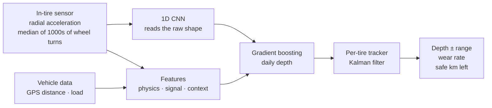

# 🛞 TreadCast

**How much tread is left on each truck tire, and how many km until it must be changed, from a sensor inside the tire.**

[](https://github.com/saeedm31/TreadCast/actions/workflows/ci.yml)
[](https://www.python.org/)
[](https://pytorch.org/)
[](#-run-it-with-docker)
[](LICENSE)

▶️ **[Live app](https://sh-treadcast.streamlit.app)** · 🧠 **[How it works](#-how-it-works)** · 🐳 **[Run with Docker](#-run-it-with-docker)** · 📄 **[Approach in detail](docs/approach.md)**

> **Simulated data.** There is no public data from in-tire sensors, so a physics-based simulator stands in for a
> truck fleet. That has one big advantage: the true tread depth is known every day, so every model can be scored
> honestly. The numbers show the method works on the simulation, not that it works on real tires.

---

## 💡 The problem

Fleets check tread depth by hand, with a gauge, a few times per tire life at service visits. Between two visits
a fast-wearing tire can drop below the safe limit unnoticed, and slow-wearing tires get changed too early.

Many truck tires now carry a small sensor glued to the inner liner. Besides pressure and temperature, it measures
**radial acceleration**. Can that tell us the tread depth every day, and how many km are left?

It is hard because:

- **Wear barely moves the signal.** From new (21 mm) to worn (3 mm) the tire's radius shrinks by about 3%.
- **Other things move it more:** load, pressure, temperature, speed and road roughness.
- **Labels are rare:** real depth is only known when a tire is new and at each gauge reading.

## 🧠 How it works



1. **Sensor signal.** Each wheel turn the sensor reads about v²/R off the road, drops to ~0 g in the contact patch,
   and spikes at entry and exit. Lining up thousands of steady turns by angle and taking the median removes the
   random road bumps (noise falls with 1/√N) and keeps the wear signature.
2. **Physics features.** A worn tire has a smaller radius, so it turns more often per km (turn count vs GPS distance).
   It is also stiffer, so its contact patch is shorter and its edges sharper, and its tread blocks ring at a higher frequency.
3. **1D CNN** (PyTorch) reads the raw 256-point template plus the operating conditions. Mileage is left out on purpose,
   so it must learn from the signal shape. Its out-of-fold output is one more feature for the next step.
4. **Gradient boosting** fuses everything into a daily depth estimate. Mileage may only push the depth down (monotone constraint).
5. **Per-tire tracker** (Kalman filter: depth + wear rate) turns noisy daily estimates into one depth that only goes down,
   a wear rate, and a 95% range. **Km left = (depth − limit) ÷ wear rate.** The *safe* value uses the low end of the range.
6. **Labels.** New depth + gauge readings at services; between two readings, straight-line pseudo-labels with a lower
   weight. Pseudo-labels are for training only; scores use the true depth and real readings.
7. **Honest testing.** Three whole trucks (one per route type) are held out, and training only uses data from before
   a cutoff date.

## 📊 Results

Scored on the held-out trucks (tires the models never saw). Full report in the app's **Model report** tab and in
[`artifacts/metrics.json`](artifacts/metrics.json), rebuilt by GitHub Actions on every change.

**Tread depth error** (mean absolute error vs the true depth, every day of 29 unseen tires):

| Model | Error (mm) |
|---|---|
| Mileage only (the baseline) | 1.62 |
| Gradient boosting, context only (speed, load, pressure, mileage...) | 1.14 |
| + physics features (rolling radius, contact patch) | 0.68 |
| + signal features (spikes, edges, ringing) | 0.53 |
| 1D CNN alone, on the raw template | 0.43 |
| + CNN output (final daily model) | 0.32 |
| **+ per-tire tracker (what the app shows)** | **0.22** |

- **Against real gauge readings:** 0.32 mm, vs 1.82 mm for mileage only.
- **Forward in time** (only days after the training cutoff): 0.26 mm, vs 2.02 mm.
- **Km left:** typical error 6%. The *safe* km left, which errs towards changing early, is too high on 14% of days.
- **Safety:** of the days a tire drove below 3 mm, TreadCast had flagged **92%**; service checks alone, **8%**.
- **Hardest case:** urban trucks at low speed (0.37 mm), where the tread ringing is harder to read.

## 🖥️ The app

- **Fleet:** every tire with its depth ± range, safe km left, days left, and a status: 🔴 replace now, 🟠 plan a change, 🟢 OK.
- **One tire:** estimated depth vs true depth, gauge readings, the mileage-only guess, and km left over the tire's life.
- **Sensor signal:** sliders for depth, load, pressure, speed and temperature, to see how each one changes the signal.
- **Model report:** errors by model, route, speed and axle; km-left error; how many below-limit days each policy catches.

## 🐳 Run it with Docker

```bash
git clone https://github.com/saeedm31/TreadCast.git && cd TreadCast
docker compose run --rm pipeline     # simulate the fleet, train (with the 1D CNN), score -> ./artifacts
docker compose up app                # open http://localhost:8501
```

Two images from one `Dockerfile`:

| Image | What's in it | Use |
|---|---|---|
| `train` | simulator, features, models, **PyTorch (CPU)**, tests | batch job: retrain and score, writes `artifacts/` |
| `app` | Streamlit app, no PyTorch, runs as a non-root user, health check | serving: reads `artifacts/` |

The same images run on any container platform (AWS ECS, Azure Container Apps, Kubernetes, a VM).

**Without Docker:**

```bash
pip install -r requirements-train.txt
python -m treadcast            # full run (~5 min on a laptop CPU); --fast for a quick check
streamlit run app.py
pytest -q
```

## 📁 Project structure

```
treadcast/
  config.py            all numbers in one place: tire size, limits, routes, noise levels
  sim/fleet.py         truck fleet: daily driving, load, pressure, temperature, true wear, services
  sim/signal.py        radial acceleration around the contact patch, and what the sensor sends
  features.py          physics, signal and context features, one row per tire per day
  labels.py            gauge readings + pseudo-labels with weights
  models/baseline.py   mileage-only baseline (the model to beat)
  models/template_model.py   1D CNN (PyTorch), with a PCA fallback when PyTorch is missing
  models/gbm.py        gradient boosting on the fused features, monotone in mileage
  tracker.py           per-tire Kalman filter, remaining km and its safe value
  evaluate.py          scores on held-out trucks
  pipeline.py          end to end; python -m treadcast
app.py                 Streamlit app
Dockerfile, docker-compose.yml
.github/workflows/     CI (tests, Docker build, app health check) and the training pipeline
```

## ⚠️ Limits

- The simulator is built from published physics of tire-mounted sensors, but it is a simplification. A real project
  starts with test-drum data (tires buffed to known depths) and an instrumented fleet.
- The true km left uses each tire's own lifetime wear rate, which a real fleet only knows after the tire is removed.

## License

[MIT](LICENSE)
