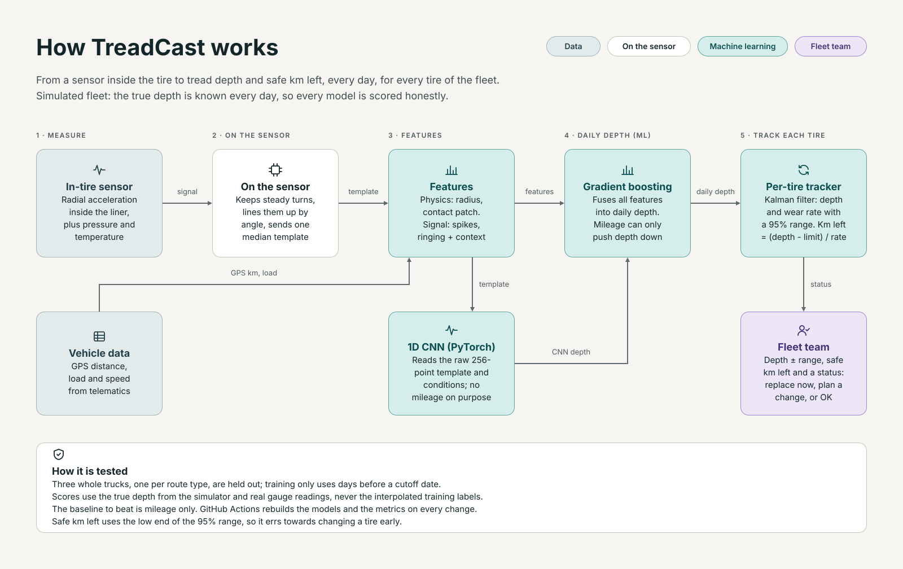

# Architecture

The physics and modelling choices are explained step by step in [approach.md](approach.md). This page is the
system view: what runs where, and what each part hands to the next.

## The pipeline

| Step | Code | In | Out |
|---|---|---|---|
| Simulate the fleet | `sim/fleet.py`, `sim/signal.py` | routes, tire models, physics | daily driving, true wear, services, the sensor's daily template |
| Features | `features.py` | template + vehicle data | one row per tire per day: physics, signal and context features |
| Labels | `labels.py` | gauge readings at services | real labels, plus straight-line pseudo-labels between readings (weight 0.3) |
| Baseline | `models/baseline.py` | mileage | the depth a mileage-only rule would guess |
| 1D CNN | `models/template_model.py` | the 256-point template + conditions, no mileage | a depth estimate, out-of-fold (GroupKFold by tire) for training rows |
| Gradient boosting | `models/gbm.py` | all features + the CNN estimate | daily depth; mileage can only push it down (monotone constraint) |
| Tracker | `tracker.py` | daily depths of one tire | depth and wear rate with a 95% range; km left and safe km left |
| Evaluate | `evaluate.py` | held-out trucks | `artifacts/metrics.json` |

`python -m treadcast` runs it end to end (`pipeline.py`); `--fast` is a quick run for CI.

## What runs where

| Piece | Local | Docker | GitHub Actions | Public demo |
|---|---|---|---|---|
| Pipeline (simulate, train, score) | `python -m treadcast` | `train` image: `docker compose run --rm pipeline` | `pipeline.yml` on every change; commits `artifacts/` | - |
| App | `streamlit run app.py` | `app` image (no PyTorch, non-root, health check) | `ci.yml` builds it and checks it starts | Streamlit Cloud reads `artifacts/` |
| Tests | `pytest -q` | inside the `train` image | `ci.yml`, plus a quick pipeline run with the CNN | - |

Two images from one `Dockerfile` keep serving small: the app only reads the artifacts and never imports PyTorch.
The same images run on any container platform (AWS ECS, Azure Container Apps, Kubernetes, a VM).

## Path to a real fleet

| Step | What changes |
|---|---|
| Calibrate | Test-drum data: tires buffed to known depths, measured under set loads, pressures and speeds |
| Ingest | Daily templates and telematics (GPS distance, axle load) from the fleet platform instead of the simulator |
| Labels | Gauge readings from workshops, linked to tire IDs and positions |
| Train | The same pipeline as a scheduled batch job; models and metrics versioned |
| Serve | Fleet view in the app or in the existing fleet portal; alerts when a tire reaches "plan a change" |
| Monitor | Error at each new gauge reading, by route, axle and tire model; retrain when it drifts |

More: [approach](approach.md) · [model card](model_card.md) · [data card](data_card.md)
